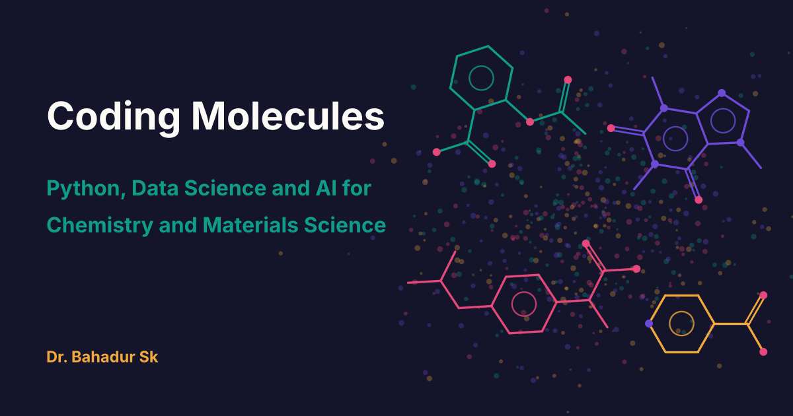

# Coding Molecules: Python, Data Science and AI for Chemistry and Materials Science

[](https://bahadursk.github.io/molecules-data-python/intro.html)

<h2 align="center">
  📖 <a href="https://bahadursk.github.io/molecules-data-python/intro.html"><b>Read the book online → bahadursk.github.io/molecules-data-python</b></a>
</h2>

<p align="center">
  <a href="https://bahadursk.github.io/molecules-data-python/intro.html"></a>
</p>

> [!TIP]
> **Start reading here: [https://bahadursk.github.io/molecules-data-python/intro.html](https://bahadursk.github.io/molecules-data-python/intro.html)**. Every chapter runs in your browser with one click (Colab or Binder), no installation needed.

[](https://doi.org/10.5281/zenodo.24583664)
[](https://bahadursk.github.io/molecules-data-python)
[](https://creativecommons.org/licenses/by/4.0/)

By **Dr. Bahadur Sk** ([ORCID 0000-0002-7098-5429](https://orcid.org/0000-0002-7098-5429)), Koneru Lakshmaiah Education Foundation.

An interactive, open Jupyter Book that teaches Python through chemistry, from school level to research level, and applies machine learning across chemistry and materials science.

- **Part I** Python fundamentals, every idea taught through a chemical problem
- **Part II** NumPy, pandas, Matplotlib, Seaborn, Plotly, SciPy, SymPy, pint
- **Part III** Cheminformatics with RDKit and 3D visualisation with py3Dmol
- **Part IV** Kinetics, thermodynamics, spectroscopy, quantum chemistry, MD, crystals
- **Part V** Machine-learning foundations for chemists
- **Part VI** ML in medicinal, organic, analytical, physical chemistry, catalysis, materials, energy, polymers, biochemistry, generative design and LLMs

## Build locally

```bash
conda env create -f environment.yml && conda activate mdp
python tools/build_book.py   # regenerate notebooks and the table of contents
jupyter-book build book      # HTML in book/_build/html
```

## Writing a chapter

Chapters are written as Jupytext MyST files in `src/<chapter>.md` and converted to notebooks in `book/` by `tools/build_book.py`. The outline lives in `tools/chapters.py`.

## Licence

Code: MIT. Text and figures: CC BY 4.0.

## How to cite

> Sk, B. (2026). *Coding Molecules: Python, Data Science and AI for Chemistry and Materials Science*. Zenodo. https://doi.org/10.5281/zenodo.24583664

This DOI covers all versions and always resolves to the latest release. To cite version 1.0 specifically, use [10.5281/zenodo.24583665](https://doi.org/10.5281/zenodo.24583665). See also [`CITATION.cff`](CITATION.cff) or the "Cite this repository" button on GitHub. Each new GitHub release is archived on Zenodo automatically.
